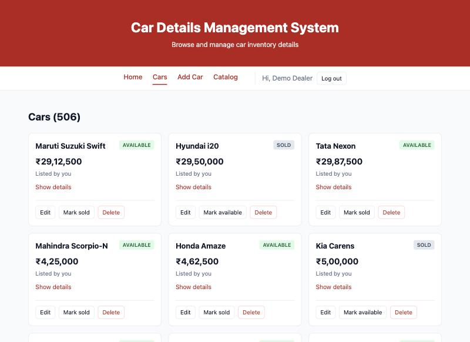
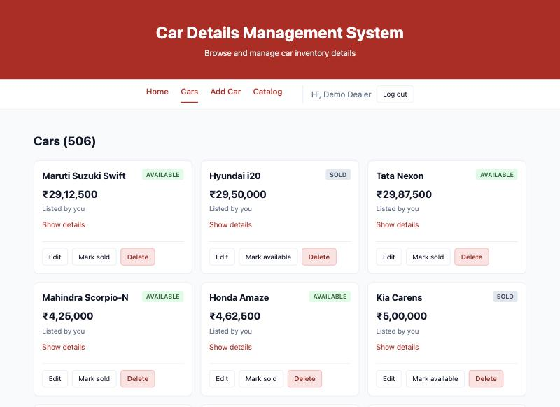

# Assignment 7 — AI-Assisted UI Customization and Design

**Course:** ITUE301 · **CO6** · Week 13
**AI used:** Google Gemini API, model `gemini-3.5-flash-lite` (the default `gemini-flash-latest` and `gemini-3.8-flash` both returned **503 high demand** at the time).
**Tool:** [`backend/scripts/ai-design-review.js`](../backend/scripts/ai-design-review.js) — `cd backend && npm run ai:design`
**Evidence:** Gemini's unedited answer [`a7-gemini-suggestions.md`](evidence/a7-gemini-suggestions.md) / [`.json`](evidence/a7-gemini-suggestions.json) (includes the exact prompt) · contrast checks [`a7-contrast-check.txt`](evidence/a7-contrast-check.txt) · target sizes [`a7-target-sizes.txt`](evidence/a7-target-sizes.txt) · screenshots before/after.

---

## 1. Method
1. **Inputs sent to Gemini** (one multimodal request):
   - two screenshots of the real app — the car list ([`a7-before-cars.jpg`](evidence/a7-before-cars.jpg)) and the Add Car form ([`a7-before-add.jpg`](evidence/a7-before-add.jpg));
   - the full `index.css` (design tokens as CSS custom properties) and `App.css`;
   - a short description of the app and its component class names.
   No user data was sent — only stylesheets and screenshots of demo inventory. The key is read from `backend/.env` and sent in a header.
2. **Prompt engineering** — the prompt gave Gemini a role (*senior UI/UX designer*), the concrete context above, three goals (visual hierarchy, WCAG 2.1 AA accessibility, consistency), a constraint (*prefer changes through CSS custom properties; do not invent features*), and a fixed output format: exactly 5 suggestions as JSON (`title, problem, change, css, rationale, accessibility`), requested with `responseMimeType: application/json` and `temperature: 0.4` for focused rather than creative answers. Structured output made it easy to save, compare and quote unedited.
3. **Verification before implementing** — every factual claim was checked: contrast ratios computed with the WCAG formula, target sizes measured in the browser, the stylesheet searched for focus rules.
4. **Implementation** through new CSS custom properties, then re-measured.

---

## 2. What Gemini suggested and what I found
| # | Gemini's suggestion | Gemini's claim | What I measured | Decision |
|---|---|---|---|---|
| 1 | Filled red style for the **Delete** button | Red text on white *"failing WCAG contrast requirements"* | Text `#b91c1c` on white = **6.47:1** — passes AA (4.5:1). The border `#fecaca` is only 1.45:1, but the button is identified by its text | **Adopted for visual hierarchy**, not as a contrast fix — the accessibility claim is **false** |
| 2 | Visible `:focus-visible` ring on all interactive elements | App relies on inconsistent browser outlines | **True**: no `focus` rule existed anywhere. Brand colour as ring = **6.18:1** against the page | **Adopted as suggested** |
| 3 | Larger padding on card actions (`8px 12px`) | Targets *"smaller than the recommended minimum"*; cites SC 2.5.5 | Buttons were **30 px** tall — already pass WCAG 2.2 AA **2.5.8 (24 px)**. 2.5.5 (44 px) is **AAA**, not required. Gemini **missed** the real failure: **"Show details" was 22 px** | **Adapted**: `6px 12px` + `min-height` token; fixed "Show details" to 26 px |
| 4 | Darker **Sold** badge | `#475569` on `#e2e8f0` is hard to read | **6.15:1** — passes AA | **Rejected**: false premise; changing it would only alter the look |
| 5 | Darker input borders + focus state | Borders blend into the background | **True**: `--border #e2e8f0` on white = **1.23:1**, fails WCAG 1.4.11 (3:1 for component boundaries). But Gemini's fix `#cbd5e1` = **1.48:1 — still fails** | **Adapted**: new token `--input-border: #8a94a6` = **3.06:1**; brand-coloured border on focus. Dropped Gemini's `outline: none`, which would have removed the focus ring from #2 |

---

## 3. Changes implemented (all through CSS custom properties)
New tokens in `frontend/src/index.css`:

```css
--focus-ring: #b91c1c;    /* 6.18:1 vs --bg, above the 3:1 needed for focus indicators */
--input-border: #8a94a6;  /* 3.06:1 vs white — inputs meet WCAG 1.4.11 (was 1.23:1) */
--danger: #991b1b;
--danger-bg: #fee2e2;
--danger-border: #fca5a5;
--target-min: 24px;       /* WCAG 2.2 AA (2.5.8) minimum target size */
```

| Suggestion | CSS change | Result |
|---|---|---|
| #2 focus ring | `a, button, input, select, textarea :focus-visible { outline: 2px solid var(--focus-ring); outline-offset: 2px }` | Tab into "Make" → `:focus-visible` true, 2 px red ring ([`a7-after-focus.png`](evidence/a7-after-focus.png)) |
| #5 input borders | `.form input/select/textarea`, `.search` use `var(--input-border)`; on `:focus` the border becomes `var(--focus-ring)` | Boundaries visible (3.06:1); the field being typed in is obvious |
| #1 delete button | `.action-danger { color: var(--danger); background: var(--danger-bg); border-color: var(--danger-border) }` | Destructive action stands out from Edit / Mark sold ([`a7-after-cars.jpg`](evidence/a7-after-cars.jpg)) |
| #3 targets | `.action { padding: 6px 12px; min-height: var(--target-min) }`, `.link-button { padding: 2px 0; min-height: var(--target-min) }` | Buttons 30 → 34 px; "Show details" 22 → **26 px** (now passes 2.5.8) |

Using tokens means the theme can be changed in one place, and each value carries its contrast reasoning next to it.

| Before | After |
|---|---|
|  |  |

---

## 4. Critical evaluation of the AI output
**What it did well**
- Fast, well-structured review: five relevant topics in one call, returned exactly in the requested JSON format.
- Two suggestions were correct and useful without changes (the missing focus styles; the weak input borders as a problem).
- It used the screenshots meaningfully (pointed to specific buttons and badges) and stayed within the CSS-variables constraint.

**Where it was wrong**
- **Two of five accessibility claims were false** (#1 text contrast, #4 badge contrast). Both colour pairs pass AA comfortably (6.47:1 and 6.15:1). Gemini judged by eye, not by calculation, and stated the failures confidently.
- **One fix did not fix the problem it identified** (#5): `#cbd5e1` raises the border contrast from 1.23:1 to only 1.48:1, still far below 3:1.
- **Wrong standard cited** (#3): presented SC 2.5.5 (Level **AAA**) as a requirement, while the AA criterion 2.5.8 was already met.
- **It missed a real failure** (the 22 px "Show details" link), found only by measuring.
- **Suggestions conflicted with each other**: #5's `outline: none` would have cancelled #2's focus ring. Applying the output blindly would have made keyboard focus worse.

**Bias and limits**
- The suggestions follow a common generic "SaaS dashboard" taste (filled pastel buttons, slate greys from the Tailwind palette). They contain no understanding of this app's users (dealers working through a long inventory) or of brand intent.
- Every suggestion was accessibility-flavoured because the prompt asked for that — the output reflects the prompt as much as the design.
- Lower-cost model (`flash-lite`, used because the larger models were overloaded); a larger model might have caught more, but the conclusion is the same: **verify, then implement**.

**Privacy and responsible use**
- Only stylesheets and screenshots of demo data were sent; no personal data, tokens or keys. Screenshots of a real system could contain customer names or registration numbers and would need anonymising first.
- The AI advised; every change was decided, adjusted and verified by a person. AI-generated text in the app (Week 13) is likewise labelled and editable.
- AI output was kept unedited in the evidence so the critique can be checked against it.

**Verdict:** useful as a quick second pair of eyes that produced a good checklist, but **not trustworthy as an accessibility authority** — 2 of 5 claims were false, 1 fix was insufficient, and 1 real issue was missed. Measuring was what made the result correct.

---

## 5. Rubric checklist
| Criterion | Marks | Where |
|---|---|---|
| AI integration for design | 4 | §1 Gemini API call from `ai-design-review.js` with screenshots + CSS, prompt engineering, saved unedited output |
| Design implementation | 3 | §3 four suggestions implemented (one as-is, three adapted) through CSS custom properties, verified with measurements and before/after screenshots |
| Critical evaluation | 3 | §2 claim-by-claim verification, §4 strengths, errors, bias, privacy and verdict |
