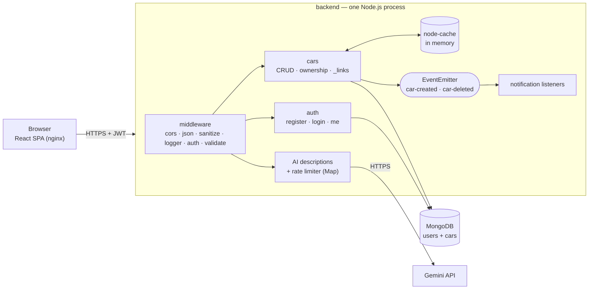
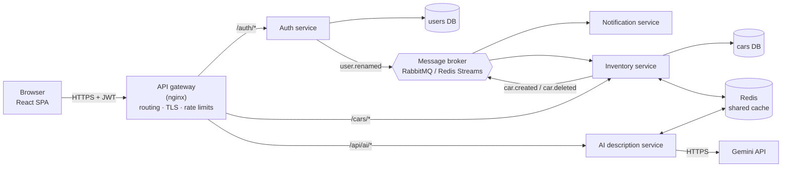

# Assignment 4 — Monolithic vs Microservices Architecture Analysis

**Course:** ITUE301 · **CO4** · Week 10
**System:** Car Details Management System as built in Practicals 1–13 (`backend/`, `frontend/`, `docker-compose.yml`).

---

## 1. Current architecture: a modular monolith

All backend features run in **one Node.js process** (one Express app, one deployable Docker image) with **one MongoDB database**. Inside, the code is already split by feature.

| Module (code) | Responsibility | Size |
|---|---|---|
| `routes/auth.js`, `controllers/authController.js`, `models/User.js`, `middleware/auth.js` | accounts, passwords, JWT | ~107 lines |
| `routes/cars.js`, `controllers/carsController.js`, `models/Car.js`, `cache.js`, `links.js` | inventory, ownership, caching, hypermedia | ~227 lines |
| `events/carEvents.js`, `events/listeners.js` | background notifications | ~36 lines |
| `routes/ai.js`, `services/ai.js`, `middleware/rateLimit.js` | Gemini descriptions | ~118 lines |

**Coupling between modules is low:** the only place one feature reads another's data is `populate('owner', 'name')` in the cars controller (5 calls), which joins each car to its owner's name in the `users` collection.

---

## 2. Proposed microservices decomposition (4 services)

Each service owns one business capability **and its own data**; none reads another's database.

| Service | Owns | Endpoints / work | Data | Comes from |
|---|---|---|---|---|
| **Auth** | users, passwords, token issuing | `POST /auth/register`, `POST /auth/login`, `GET /auth/me` | `users` | `routes/auth.js` … |
| **Inventory** | cars, ownership rules, cache | `/cars`, `/cars/:id` (GET/POST/PUT/PATCH/DELETE) | `cars` (+ Redis) | `routes/cars.js` … |
| **Notification** | side effects after car events | consumes `car.created`, `car.deleted` from the broker; sends email/SMS | none (or its own log) | `events/listeners.js` |
| **AI description** | Gemini integration, cost control | `POST /api/ai/generate-description` | rate-limit counters in Redis | `routes/ai.js`, `services/ai.js` |

### What changes when splitting
1. **Token check without calling Auth.** Every service verifies the JWT locally with the shared secret (or Auth's public key if switched to RS256 signing). No network hop per request — this works *because the JWT is stateless* (§5).
2. **No cross-database `populate`.** Inventory cannot join `users` any more. Each car stores `ownerId` and a copy of `ownerName`; when a user is renamed, Auth publishes `user.renamed` and Inventory updates its copies (**eventual consistency**).
3. **`EventEmitter` → message broker.** In-process events cannot reach another service. The broker also *persists* events, so a notification is not lost if the Notification service is down — which today it would be (see Week 10).
4. **In-memory state → Redis.** `node-cache` and the rate-limiter `Map` live inside one process; with several services/instances they must be shared (§5).
5. **A gateway** gives the browser one origin (no CORS per service), terminates TLS, and applies global rate limits.

---

## 3. Trade-offs

| Aspect | Monolith (current) | Microservices (proposed) | Better for this project |
|---|---|---|---|
| **Development speed** | one repo, one `npm run dev`, refactor across features freely | changes spanning services need versioned APIs and coordinated releases | **Monolith** |
| **Deployment** | one image; one `docker compose up` | 4 services + gateway + broker + Redis; needs orchestration | **Monolith** |
| **Scaling** | scale everything together, even if only `GET /cars` is busy | scale Inventory alone (A3 showed `GET /cars` is the CPU hot spot) | Microservices |
| **Fault isolation** | a crash or memory leak takes down all features | a failing AI service does not affect login or inventory | Microservices *(AI already degrades gracefully)* |
| **Performance** | in-process calls (nanoseconds), one DB join | network hops between services, no joins, serialisation | **Monolith** |
| **Data consistency** | one database, immediate consistency | each service owns data → eventual consistency, duplicated `ownerName` | **Monolith** |
| **Testing** | 30 tests run one app in ~3 s | contract tests per service + end-to-end across services | **Monolith** |
| **Observability** | one log stream | needs distributed tracing and correlation IDs | **Monolith** |
| **Team autonomy** | fine for one developer / small team | independent teams own and release services | Microservices *(not our situation)* |
| **Technology choice** | one stack | each service may use the best stack | Microservices *(not needed)* |
| **Infrastructure cost** | 3 containers | ≈ 8 containers (4 services, gateway, broker, Redis, DBs) | **Monolith** |

---

## 4. Decision

**Keep the modular monolith.** At this size (~500 lines of backend code, one team, a few hundred requests per second measured in A3) microservices would add network calls, eventual consistency, a broker, a gateway and distributed debugging — significant cost — to solve problems this system does not have yet.

The monolith is already **structured for a later split**: features live in separate folders, talk through small interfaces, and share almost no data. If the system grows, extract in this order:

1. **AI description service** first — external dependency, separate cost and quota, already isolated and failure-tolerant.
2. **Notification service** — natural fit once a real message broker is needed for reliable delivery.
3. **Inventory vs Auth** — only if one of them needs to scale or be released independently.

What to do *now* instead: make the monolith **stateless** (§5) so it can scale horizontally — several identical instances behind a load balancer — which gives most of the scaling benefit without splitting the code.

---

## 5. Stateless services note

A service is **stateless** when any instance can handle any request because nothing a request depends on is kept in one instance's memory. That is what allows horizontal scaling and restarts without losing data.

| Part of the app | Stateless? | Why / what to change for multiple instances |
|---|---|---|
| **JWT authentication** | ✅ yes | The token carries the user's identity and signature; any instance verifies it with `JWT_SECRET`. No server-side session store. |
| **MongoDB data** | ✅ yes | Stored outside the process; every instance reads the same database. |
| **Request handling** (validation, controllers, `_links`) | ✅ yes | Depends only on the request, the token and the database. |
| **`node-cache`** (`cache.js`) | ❌ no | Each instance has its own cache. A `PATCH` on instance A clears only A's cache; B keeps serving the old car for up to 60 s. → **Redis** shared cache. |
| **AI rate limiter** (`new Map()` in `middleware/rateLimit.js`) | ❌ no | A user gets one request per 10 s *per instance* → limit multiplied by the number of instances. → counters in **Redis** (`SET key NX PX 10000`). |
| **`EventEmitter` notifications** (`events/`) | ❌ no | Events exist only in the emitting process; lost on crash or restart. → **message broker** with durable queues. |
| **Frontend (nginx)** | ✅ yes | Static files only; the session lives in the browser (JWT). |

**Conclusion:** the request path is already stateless thanks to JWT; three in-memory components (cache, rate limiter, events) are the only obstacles to running several instances. Moving them to Redis and a broker is the prerequisite for scaling out — whether as a monolith or as microservices.

---

## 6. Rubric checklist
| Criterion | Marks | Where |
|---|---|---|
| Architecture diagrams | 4 | §1 current monolith (Mermaid) + module table; §2 proposed 4-service architecture with gateway, per-service databases, Redis and broker |
| Trade-off table | 3 | §3, eleven aspects compared with a verdict for this project |
| Decision + stateless note | 3 | §4 decision, reasoning and extraction order; §5 component-by-component statelessness audit |
