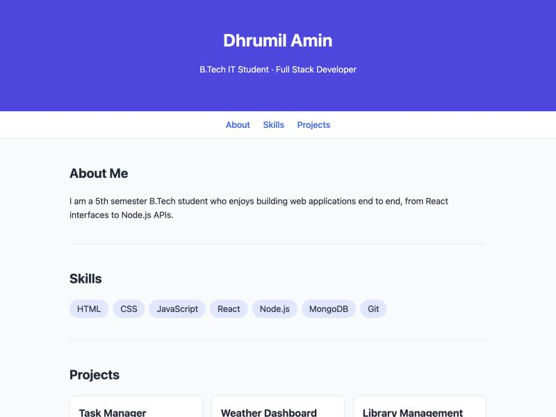

# Week 1 — Introduction to React and Component Architecture

## Objective
Set up a React development environment with Vite and build a static portfolio UI from independent, reusable components.

## What I built
- Scaffolded the app with `npm create vite@latest portfolio -- --template react`.
- `Header`, `About`, `Skills`, `Footer` components in `src/components/`, composed in `App.jsx`.
- Props: `name`/`role`/`themeColor` → Header, `bio` → About, `skillList` → Skills, `name`/`email` → Footer.
- Supplementary: `NavBar` (section links passed as a prop) and a `themeColor` prop applied as an inline style on the Header.
- Post-lab: `Projects` component rendering 3 projects from an array prop.

## Key questions
**What is the role of each component in the overall UI structure?**
Each component owns one part of the page: Header shows identity, NavBar handles navigation, About/Skills/Projects show content, Footer shows contact info. `App` only composes them and holds the data. Because each has one responsibility, any one can be changed without touching the others.

**How does React re-render when props change?**
When a parent re-renders with new prop values, React calls the child function again with the new props, compares the returned elements with the previous ones (reconciliation) and only updates the DOM nodes that actually changed. Props are read-only inside the child.

**Why is component reusability important in large-scale applications?**
The same component can be reused with different props instead of copying markup (e.g. `Skills` works for any list). That removes duplication, keeps the UI consistent and means a bug is fixed in one place.

## Errors & fixes
| Symptom | Cause | Fix |
|---|---|---|
| Linter warning `react(purity): Cannot call impure function during render` in `Footer.jsx` | `new Date().getFullYear()` was called inside the component body, so it runs on every render | Moved it to a module-level constant `year`, computed once |

## Evidence

## Post-lab work done
- [x] Added a Projects component with 3 hardcoded projects
- [x] Passed different prop values (themeColor, skills) and observed the UI update
