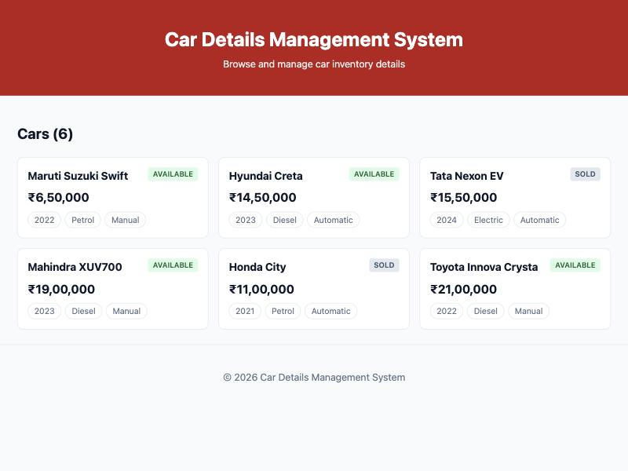

# Week 1 — Introduction to React and Component Architecture

## Objective
Set up a React project with Vite and build a static car inventory page from reusable, single-responsibility components.

## What I built
- Scaffolded `frontend/` with `npm create vite@latest frontend -- --template react`.
- `Header` (title, subtitle), `CarList` (array of cars), `CarCard` (one car), `Footer` (app name).
- Car data moved to `src/data/cars.js` and passed down as props: `App → CarList → CarCard`.
- `CarCard` shows make/model, a status badge, the price formatted in Indian rupees, and year/fuel/transmission chips.

## Key questions
**What is the role of each component in the overall UI structure?**
`Header` and `Footer` are page chrome, `CarList` lays out the collection and shows the count, and `CarCard` renders exactly one car. `App` only composes them and owns the data. Each component has one responsibility, so changing how a card looks never touches the list or the data.

**How does React re-render when props change?**
When a parent renders with new props, React calls the child function again, compares the new element tree with the previous one and updates only the DOM nodes that changed. The `key={car.id}` on each `CarCard` lets React match cards between renders instead of rebuilding the whole list.

**Why is component reusability important in large-scale applications?**
`CarCard` is written once and used for every car; adding a 7th car means adding data, not markup. A fix or style change in one component applies everywhere it is used.

## JSX notes
- `className` instead of `class` (`class` is a reserved word in JavaScript).
- Expressions in `{}`: `{car.make} {car.model}`, template literal for `className={`badge badge-${car.status}`}`.
- Self-closing tags for components without children: `<CarCard key={car.id} car={car} />`.

## Errors & fixes
| Symptom | Cause | Fix |
|---|---|---|
| (avoided) Linter rule `react(purity)` flags `new Date()` called inside a component body — it is impure and re-runs on every render | Footer needs the current year | Computed `year` once at module level in `Footer.jsx` instead of inside the component |

## Evidence

## Post-lab work done
- [x] Rendered the car list dynamically from an array with `.map()` and stable keys
- [x] Experimented with prop values (title/subtitle, car data) and observed the UI update
