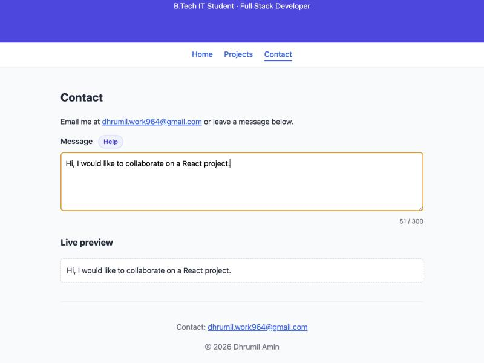
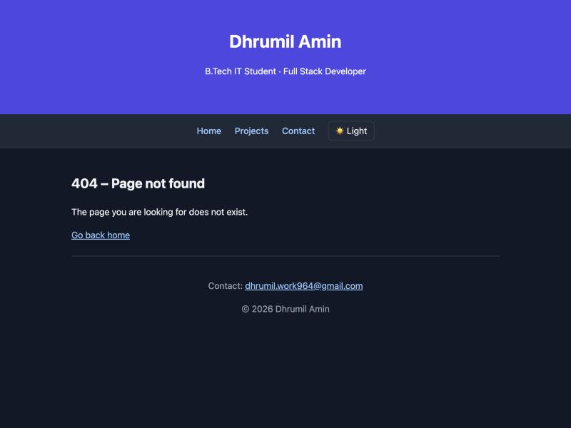

# Week 2 — State Management and Routing in React

## Objective
Add client-side routing with React Router and manage dynamic UI state with `useState` in the existing portfolio app.

## What I built
- Installed `react-router-dom` and wrapped `<App />` in `<BrowserRouter>` once, in `main.jsx`.
- Routes `/`, `/projects`, `/contact` rendering `Home`, `Projects`, `Contact` from `src/pages/`.
- `NavBar` now uses `NavLink` instead of `<a>`, so there is no full page reload and the active route gets an `active` class.
- `Contact` page: `message` state bound to a controlled `<textarea>` (live preview + character count) and `showHelp` state toggling help text, auto-hidden after 3 s by a `useEffect` that clears its timer in the cleanup.
- Post-lab: catch-all `*` route rendering a `NotFound` page; dark/light toggle (`darkMode` state in `App`) that adds a `dark` class to `<html>`, with colours as CSS variables.

## Key questions
**What is the role of each component in the overall UI structure?**
`main.jsx` provides the router context, `App` holds the layout (Header, NavBar, Footer stay on every page) and the route table, and each page component renders one route. Reusable pieces (`About`, `Skills`, `Projects`) are still plain components that pages compose.

**How does React re-render when props (and state) change?**
Calling a state setter like `setMessage` schedules a re-render of that component. React runs the function again with the new state, passes new props to its children and updates only the changed DOM, which is why the preview and character count update on every keystroke.

**Why is component reusability important in large-scale applications?**
Routing showed it directly: moving sections into pages needed no changes to `About`, `Skills` or `Projects`. The pages just composed the existing components.

**Why `<Link>` instead of `<a href>`?**
`<a>` makes the browser request a new HTML document and reload the whole app, losing all state. `<Link>` changes the URL with the History API and React Router renders the matching route inside the same page. I verified this by setting a variable on `window`, clicking a nav link and confirming the variable was still there.

## Errors & fixes
| Symptom | Cause | Fix |
|---|---|---|
| `npm audit` reported 2 moderate vulnerabilities after installing `react-router-dom@6` | All v6 releases are affected by an open-redirect advisory (GHSA-wrjc-x8rr-h8h6) fixed only in v7.18.4 | Upgraded to the latest v7, whose declarative mode is the same API as v6 (`BrowserRouter`, `Routes`, `Route`, `Link`) — 0 vulnerabilities |
| Help text colours would be unreadable in dark mode | Hardcoded light hex colours in `App.css` | Moved colours to CSS variables on `:root` and overrode them under `:root.dark` |

## Evidence
Contact page with controlled input, live preview and character count:

404 page in dark mode:

## Post-lab work done
- [x] 404 Not Found route for any undefined path
- [x] Dark/light mode toggle using a second `useState` variable
- [x] Supplementary: live character count under the contact input
