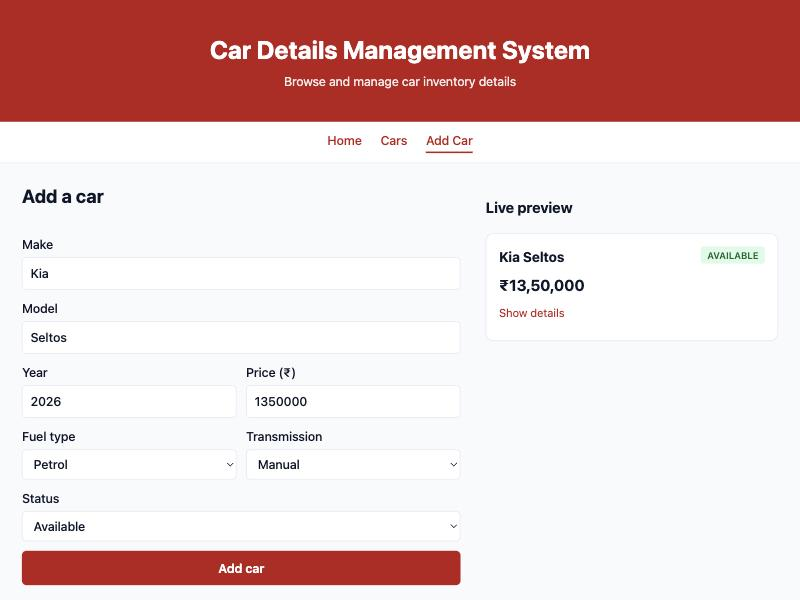
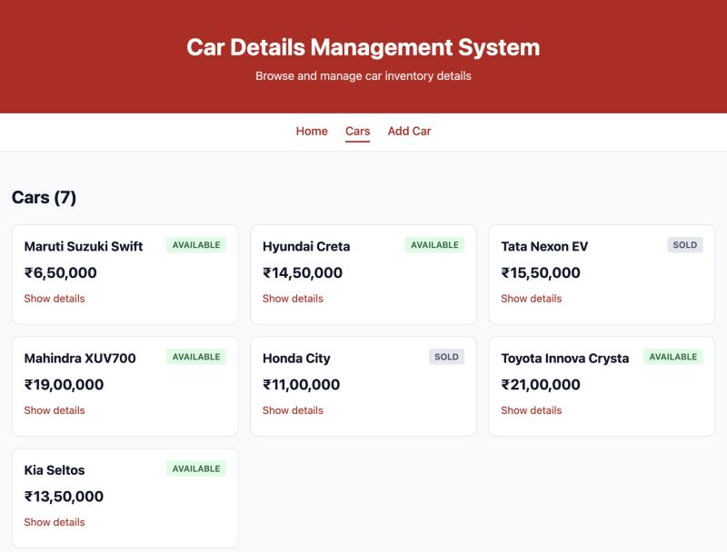

# Week 2 — State Management and Routing in React

## Objective
Extend the car app with client-side routing (React Router) and dynamic UI state (`useState`), including a controlled form that shows input in real time.

## What I built
- `<BrowserRouter>` wraps `<App />` once, in `main.jsx`.
- 3 routes: `/` Home (inventory stats), `/cars` Cars (car list), `/add` Add Car (form), plus `*` → `NotFound`.
- `NavBar` uses `NavLink`, so there is no full page reload and the active route gets an `active` class.
- **State for UI visibility:** each `CarCard` has its own `showDetails` state to show/hide year, fuel type and transmission.
- **State for form input:** `AddCar` keeps one `form` object in state; every `<input>`/`<select>` is controlled (`value` + `onChange`). A `CarCard` preview next to the form re-renders on every keystroke. Submit is disabled until make, model, year (1950 – next year) and price are valid.
- **Lifting state up:** the `cars` array moved from a static import into `useState` in `App`, so `AddCar` can add a car (via an `onAdd` prop) and `Home`/`Cars` both see it.
- **useEffect with cleanup:** `Notice` shows "<car> added to inventory." and auto-dismisses after 3 s. The effect returns `clearTimeout(timer)` so the timer is cancelled if the notice is closed early or replaced. `clearNotice` is wrapped in `useCallback` so the effect does not restart on every render of `App`.

## Key questions
**What is the role of each component in the overall UI structure?**
`main.jsx` provides router context. `App` owns shared state (`cars`, `notice`) and the route table; Header/NavBar/Footer stay on every page. Each page renders one route, and reusable components (`CarList`, `CarCard`) are composed by pages — `CarCard` is reused both in the list and as the live preview.

**How does React re-render when props change?**
Calling a setter (`setForm`, `setShowDetails`, `setCars`) schedules a re-render of that component. React re-runs it with the new state, passes new props down, and updates only the changed DOM. That is why the preview card updates on each keystroke: `form` changes → `AddCar` re-renders → the preview `CarCard` receives a new `car` prop.

**Why is component reusability important in large-scale applications?**
The preview needed zero new UI code — it is the same `CarCard` used in the list. Any change to how a car is displayed now applies to both places automatically.

**Why `<Link>`/`<NavLink>` instead of `<a href>`?**
`<a>` makes the browser request a new document and restarts the app, losing state — a car added on `/add` would disappear. `<Link>` updates the URL with the History API and React Router swaps the rendered route in place. Verified by setting a marker on `window`, clicking through all three links, and confirming the marker survived.

**Why must state never be mutated directly?**
React compares old and new state by reference. `cars.push(car)` keeps the same array reference, so React may skip the re-render. I always create a new array/object: `setCars(prev => [...prev, newCar])`, `setForm({ ...form, [name]: value })`.

## Errors & fixes
| Symptom | Cause | Fix |
|---|---|---|
| `npm audit` warns on every `react-router-dom@6.x` (open redirect advisory GHSA-wrjc-x8rr-h8h6) | Fixed only in v7.18.4+ | Used the latest v7 in declarative mode — same API as v6, 0 vulnerabilities |
| (avoided) Notice timer would restart on every `App` render | An inline `() => setNotice('')` is a new function each render, and it is in the effect's dependency array | Wrapped it in `useCallback(..., [])` so the reference is stable |

## Evidence
Add Car form with controlled inputs and live preview:

Car list after adding a car (7 cars, Kia Seltos added):

## Post-lab work done
- [x] 404 Not Found route for undefined paths
- [x] Second `useState` used for UI visibility (details toggle) alongside form state
- [x] `useEffect` with cleanup (auto-dismiss notice timer)
