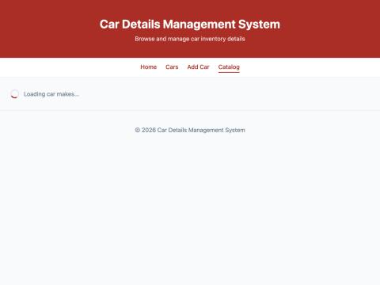
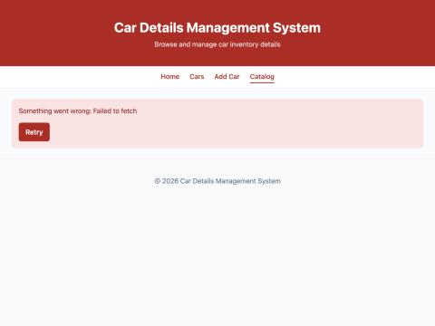
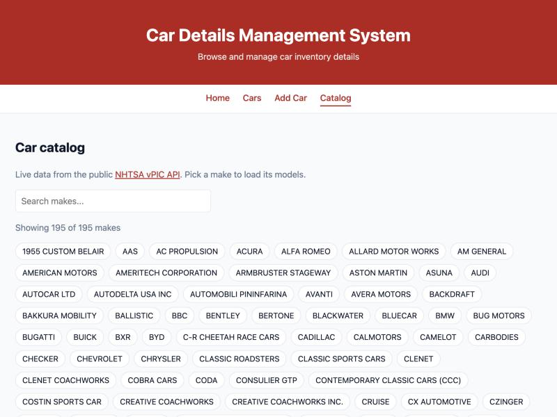
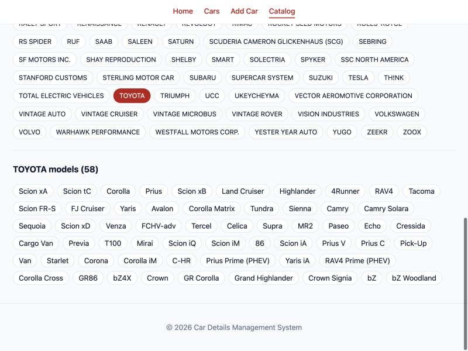

# Week 3 — API Integration and Data Rendering in React

## Objective
Consume a public REST API in React and handle asynchronous data with loading, error and success states.

## What I built
- `src/api/nhtsa.js`: `getCarMakes()` and `getModelsForMake(make)` calling the public **NHTSA vPIC API** (free, no API key, sends `Access-Control-Allow-Origin: *` so the browser can call it directly). A shared `getJson` helper throws when `res.ok` is false, because `fetch` only rejects on network errors, not on 404/500.
- New route `/catalog` → `Catalog.jsx`: three state variables `makes`, `loading`, `error`; fetches makes in `useEffect` with `async/await` and renders 195 makes sorted A–Z.
- `Spinner.jsx` (loading), `ErrorMessage.jsx` (error + optional Retry button).
- Clicking a make renders `ModelList.jsx`, which has its own loading/error/data states and re-fetches whenever the `make` prop changes (`[make, reloadKey]` dependencies).
- `AbortController` in both effects: the cleanup aborts the in-flight request if the user leaves the page or picks another make, so a stale response never overwrites newer data and state is never set after unmount.
- Post-lab: **Retry** button (increments a `reloadKey` state that is in the effect's dependency array) and a **search** input that filters the rendered makes.

## Key questions
**Why is `useEffect` required to trigger a fetch on mount instead of calling `fetch` in the component body?**
The component body runs on every render. A fetch there would call `setMakes`, which re-renders, which fetches again — an infinite loop. `useEffect(..., [reloadKey])` runs after render and only when its dependencies change, so the request fires once on mount and again only on Retry.

**What is the difference between a loading state and an error state, and why must both be handled separately?**
Loading means "no answer yet"; error means "the request finished and failed". They need different UI: a spinner tells the user to wait, an error message tells them it will not arrive and offers Retry. If only loading were handled, a failed request would leave the spinner spinning forever; `finally` guarantees `loading` is set back to false on both paths.

**How would the user experience change if loading and error states were not implemented?**
On a slow network the page would look empty or broken until data arrived, and on failure it would stay blank (or crash on `undefined.map`) with no explanation and no way to recover.

## How I tested the states
- **Data:** opened `/catalog` → 195 makes; clicked HONDA → "HONDA models (362)"; TOYOTA → 58 models.
- **Search:** typing `toy` reduced the list to TOYOTA.
- **Loading:** replaced `window.fetch` in the console with a promise that never resolves → spinner stays visible (same effect as DevTools "Slow 3G", but it stays on screen long enough to screenshot).
- **Error:** replaced `window.fetch` with one that rejects → "Something went wrong: Failed to fetch" with a Retry button; restored `fetch`, clicked Retry → 195 makes loaded.

## Errors & fixes
| Symptom | Cause | Fix |
|---|---|---|
| (avoided) A 404/500 response would be treated as success | `fetch` only rejects on network failure | `getJson` checks `res.ok` and throws `Request failed with status N` |
| (avoided) "Can't update state on unmounted component" / stale models shown after switching makes quickly | The previous request could resolve after the user navigated away or chose another make | `AbortController` aborted in the effect cleanup; `AbortError` is ignored |

## Evidence
Loading state:

Error state with Retry:

Data state — makes:

Data state — models for the selected make:

## Post-lab work done
- [x] Retry button that re-triggers the fetch on error
- [x] Search/filter input above the list
