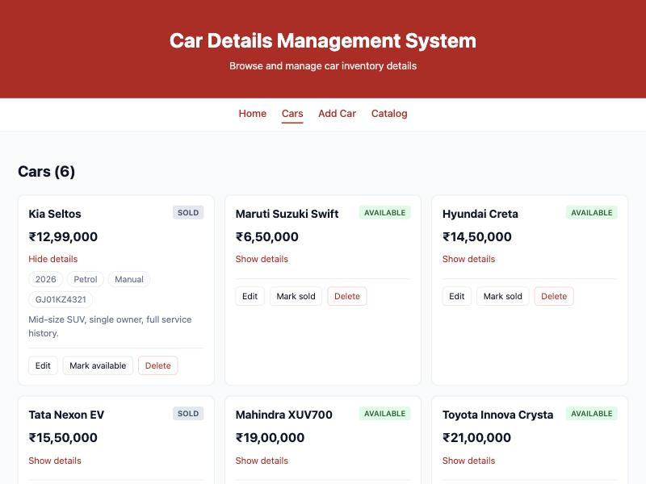
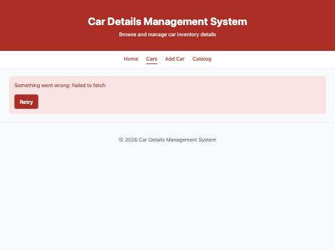

# Week 6 — Full Stack Integration: React + Node + MongoDB

## Objective
Wire the React frontend to the Node/Express/MongoDB backend so cars can be created, viewed, updated and deleted from the UI, with every change persisted in MongoDB.

## What I built
**Backend**
- `cors` middleware, first in the pipeline, allowing only the origins in `CLIENT_URL` (default `http://localhost:5173`). A request from another origin gets no `Access-Control-Allow-Origin` header, so the browser blocks it.
- Replaced `nodemon` with Node's built-in `node --watch` (see Errors & fixes).

**Frontend**
- `src/api/cars.js`: the **only** place that knows the backend URL (`import.meta.env.VITE_API_URL`, from `frontend/.env`). Exposes `getCars`, `createCar`, `updateCar`, `deleteCar`. On a non-2xx response it throws an `Error` with the API's message and `details`.
- The static `src/data/cars.js` is gone. `App` loads cars from `GET /cars` in `useEffect` with loading, error and Retry, reusing the Week 3 pattern (`Spinner`, `ErrorMessage`, `AbortController`).
- **Create:** `/add` → `CarForm` → `POST /cars`. Server errors (e.g. 409 duplicate registration, 400 field messages) are shown inside the form; the typed values are kept.
- **Read:** `/cars` and the Home stats use the API data.
- **Update:** two ways — "Mark sold/available" on each card (`PUT { status }`), and a new `/cars/:id/edit` route that reuses `CarForm` pre-filled (`PUT` with all fields).
- **Delete:** button with a `window.confirm` dialog → `DELETE /cars/:id`.
- After every successful write, state is updated **from the server's response**: `created` is prepended, `updated` replaces the old object, deleted ids are filtered out. Nothing is changed before the server confirms.
- Each card disables its buttons while its request is in flight (`busy` state) so a double click cannot send two requests.
- `CarForm` was extracted from Week 2's `AddCar` so add and edit share one form, one validation rule set and one live preview.
- Post-lab: confirmation before delete, and a success/error toast (`Notice`, now with `type`) after each operation.

## Key questions
**What changes are required on the backend (CORS) to allow the React dev server to call the Express API?**
The React app (`localhost:5173`) and the API (`localhost:5001`) are different origins because the ports differ. The browser blocks reading a cross-origin response unless the server answers with `Access-Control-Allow-Origin` for that origin. `app.use(cors({ origin: allowedOrigins }))` adds that header, and also answers the preflight `OPTIONS` request that the browser sends before a `POST`/`PUT` with a JSON body. It must be registered before the routes.

**Why should the UI update from the server response after POST/PUT/DELETE rather than assuming success?**
The server is the source of truth: it fills in defaults (`status`, `fuelType`), normalises values (`"gj 01 kz 4321"` → `"GJ01KZ4321"`), assigns the `id` and timestamps, and can reject the write. Using `created`/`updated` from the response means the screen always shows exactly what is stored. I tested this by stopping the backend and clicking "Mark sold": the badge stayed "available" and an error toast appeared. An optimistic update would have shown "sold" for a car that was never changed.

**What is the risk of not handling errors on write operations the same way as on reads?**
A failed write that is not handled looks like success, or does nothing with no explanation. The user leaves thinking the car was added or deleted while the database disagrees, and the difference only appears after a refresh. Every write here either shows the error in the form (create/edit) or as an error toast (status/delete).

## How I tested the full flow
| Step | Result |
|---|---|
| Open `/` and `/cars` | 6 seeded cars from MongoDB; Home shows 6 / 4 / 2 |
| Add Kia Seltos with registration `GJ 01 AB 1234` (already used by the seeded Swift) | Form shows "A car with this registrationNumber already exists"; stays on `/add`, inputs kept |
| Change registration to `GJ 01 KZ 4321`, submit | Redirect to `/cars`, 7 cars, Kia first, toast "Kia Seltos added." |
| "Mark sold" on Kia | Badge → sold, toast "Kia Seltos marked sold." |
| Delete Honda City | Confirm dialog "Delete Honda City? This cannot be undone." → removed, 6 cars, toast |
| Edit Kia → price 1299000 | `/cars/:id/edit` pre-filled (reg shows normalised `GJ01KZ4321`); after save the card shows ₹12,99,000 |
| **Browser refresh** on `/cars` | Kia still sold at ₹12,99,000, Honda City still gone — data persisted in MongoDB |
| Stop backend, reload | "Something went wrong: Failed to fetch" + Retry |
| Start backend, click Retry | 6 cars load |
| Stop backend, click "Mark sold" on Creta | Badge stays "available", red toast "Could not update status: Failed to fetch" |

## Errors & fixes
| Symptom | Cause | Fix |
|---|---|---|
| `npm audit`: 3 high-severity vulnerabilities after adding `cors` | They came from `nodemon` → `chokidar` → `braces` (GHSA-vfj7-8cjw-p6xm). The suggested `npm audit fix --force` would downgrade nodemon to 1.14 | Removed `nodemon`; `npm run dev` now uses Node 22's built-in `node --watch server.js`. 0 vulnerabilities, one less dependency |
| (avoided) Two terminals, frontend says "Failed to fetch" | Backend not running, or running on another port | README documents both terminals; the error state with Retry makes it visible instead of a blank page |
| (avoided) Backend URL hardcoded in several components | — | One `BASE_URL` in `src/api/cars.js`, from `VITE_API_URL` |

## Evidence
Cars loaded from the API, with the edited and toggled Kia Seltos expanded:

Backend stopped — error state with Retry:

## Post-lab work done
- [x] Confirmation dialog before deleting a car
- [x] Toast notification for successful (and failed) create/update/delete
