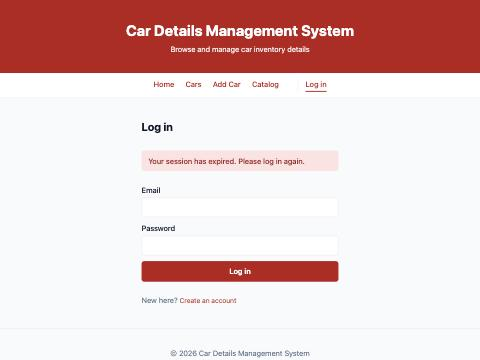

# Week 7 — Authentication and Middleware Pipeline

## Objective
Add JWT authentication and server-side input validation to the Express middleware pipeline, and protect every car route.

## What I built
**Backend**
- `models/User.js`: `name`, `email` (unique, lowercased), `password` stored as a **bcrypt hash** (`bcryptjs`, 10 salt rounds). `select: false` keeps the hash out of every query unless login asks for it with `.select('+password')`, and `toJSON` strips it as a second guard.
- `POST /auth/register` → hash → save → **201** `{ token, user }`; a duplicate email → **409**.
- `POST /auth/login` → `bcrypt.compare` → `jwt.sign({ id, email, name }, JWT_SECRET, { expiresIn: '1h' })` → **200** `{ token, user }`. Unknown email and wrong password both return the same **401** "Invalid email or password", so an attacker cannot find out which emails are registered.
- `GET /auth/me` (post-lab) returns the logged-in user from the token's `id`.
- `middleware/auth.js`: reads `Authorization: Bearer <token>`, `jwt.verify` inside `try/catch`, sets `req.user`. Missing → 401 "Authentication required"; tampered or garbage → 401 "Invalid token"; expired → 401 "Token expired, please log in again".
- `router.use(auth)` in `routes/cars.js`, so **every** `/cars` route is protected.
- **403 Forbidden**: cars now have an `owner` (set from `req.user.id`, never from the request body). Anyone logged in can read all cars; only the owner can update or delete. Another user gets 403 "You can only modify cars you listed".
- `middleware/validate.js`: server-side validation **before** the controller — required fields, types (`year: "2024"` is rejected, it must be a number), ranges, allowed values, an empty `PUT` body, and email/password format for register. Returns 400 with per-field `details`; the database is never touched.
- `JWT_SECRET` comes from `.env`; the server refuses to start without it. `.env.example` explains how to generate one.
- `npm run seed` creates a demo user (`demo@cars.test` / `demo12345`, test data only) who owns the sample cars.

**Frontend**
- `api/client.js`: one `request()` used by `api/cars.js` and `api/auth.js`; adds `Authorization: Bearer <token>` automatically.
- `context/AuthContext.jsx`: `user`, `token`, `login`, `register`, `logout`; session persisted in `localStorage` and checked with `/auth/me` on load.
- `pages/Login.jsx`: login and register on one page (toggle), showing server errors including per-field details.
- `components/ProtectedRoute.jsx`: logged-out users visiting `/`, `/cars`, `/add` or `/cars/:id/edit` go to `/login`, then back to the page they wanted.
- NavBar shows "Hi, <name>" and **Log out** (post-lab: logout clears the token on the client).
- **401 handling (post-lab):** any 401 on an authenticated request logs the user out and `/login` shows "Your session has expired. Please log in again."
- Cards show "Listed by you / <name>"; Edit / Mark / Delete render only for the owner. `EditCar` also refuses non-owners (the API would return 403 anyway).

## Key questions
**Why must passwords be hashed before storage instead of saved as plain text, even in a lab project?**
If the database leaks (a backup, a misconfigured Atlas IP rule, a log), plain-text passwords are immediately usable, and people reuse passwords on other sites. A bcrypt hash cannot be reversed; login works by hashing the attempt and comparing. bcrypt is deliberately slow and adds a random salt per password, so identical passwords get different hashes and brute-forcing them is expensive. A fast hash like plain SHA-256 can be guessed billions of times per second.

**What does the authentication middleware actually verify, and what happens if the token is missing or expired?**
`jwt.verify` checks that the signature matches the payload using `JWT_SECRET` (so it was issued by this server and not edited) and that `exp` is in the future. If either fails it throws; the middleware catches that and returns 401 instead of crashing. No token at all → 401 before verify even runs. Only when verification passes does it set `req.user` and call `next()`. Tested: no token, `not.a.token`, a real token with 5 signature characters changed, and a token with `expiresIn: -10` all return 401 with different messages.

**Why should input validation happen on the server even if the frontend already validates the same fields?**
The frontend can be skipped entirely: Postman or curl can send any body straight to the API. In the recorded run, `{"make":"  ","year":"2024","price":-1,"status":"stolen"}` was rejected by `validate.js` with four field errors. Server validation is the real gate; frontend validation only makes the form friendlier.

**401 vs 403**
401 means "I don't know who you are" (no/invalid/expired token — log in). 403 means "I know who you are, but you are not allowed" (Ravi trying to delete Demo Dealer's car).

**Where is the token stored, and what is the risk?**
In `localStorage`, so the session survives a reload. Any JavaScript running on the page can read it, so an XSS bug would leak it. React escapes rendered text, which helps; an `httpOnly` cookie would be safer (JavaScript cannot read it) but needs CSRF protection. The 1-hour expiry limits the damage of a leaked token.

## Errors & fixes
| Symptom | Cause | Fix |
|---|---|---|
| Registering with an existing email would have said "A car with this email already exists" | The 409 handler only knew about cars | `errorHandler` now picks the message by field (`email` → "An account with this email already exists") |
| After an expired token, the app logged out and went to `/login`, but the "session expired" message never showed | Two redirects raced: my `navigate('/login', { state })` and `ProtectedRoute`'s own `<Navigate>` (which won and dropped the state) | Store the notice in the auth state instead of router state; `ProtectedRoute` redirects and `Login` reads `notice` from `useAuth()` |
| Linter `react(set-state-in-effect)` on `setCars([])` inside the load effect | Clearing state synchronously in an effect causes an extra render | Derive `visibleCars = userId ? cars : []` during render instead |

## Evidence
All register / login / protected-route / validation / ownership requests and responses: [`docs/evidence/w07-auth-responses.txt`](../evidence/w07-auth-responses.txt)

| Request | Status |
|---|---|
| Register Ravi (`Ravi@Example.com`) | 201, stored as `ravi@example.com`, no password in response |
| Register same email again | 409 |
| Register blank name, bad email, 3-char password | 400, three field errors |
| Login wrong password / unknown email | 401, same message for both |
| Login correct | 200 + token |
| `GET /auth/me` with token | 200 |
| `GET /cars` no token / garbage / tampered / expired | 401 ×4 |
| `POST /cars` `{ make }` only | 400 (validation middleware) |
| `PUT /cars/:id` `{}` | 400 "Provide at least one field to update" |
| Ravi `PUT` / `DELETE` Demo Dealer's Creta | 403 / 403 |
| Demo Dealer `PUT` own Creta | 200 |
| `POST /cars` with `"owner"` in the body | 201, owner is still the logged-in user |

Browser: logged out → `/cars` redirects to `/login`; wrong password shows the error; demo login shows 8 cars with actions on its own 6 only; a newly registered user sees 8 cars and 0 action bars; an expired token in storage → automatic logout with this message:

Postman: `docs/postman/car-details-api.postman_collection.json` — run **Auth › Login (demo)** first; it saves `{{token}}`, which the collection sends as Bearer auth on every request.

## Post-lab work done
- [x] `/me` endpoint returning the logged-in user from the decoded token
- [x] Frontend handling of 401 (redirect to login with a message)
- [x] Logout that clears the token from the client
