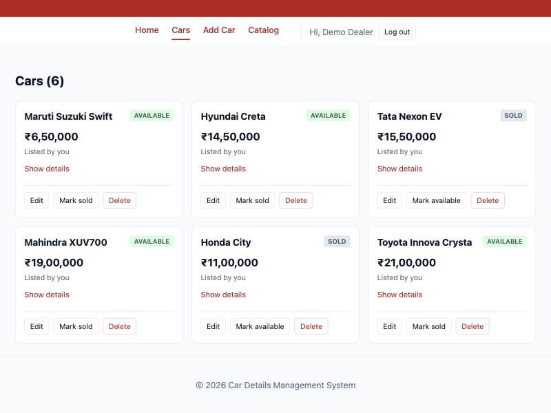

# Week 11 — Containerization with Docker and Docker Compose

## Objective
Containerize the frontend and backend and run the whole stack — frontend, backend and MongoDB — with a single `docker compose up` command.

## What I built
**`backend/Dockerfile`**
- `FROM node:22-alpine` (small base image).
- `COPY package*.json` → `RUN npm ci --omit=dev` → `COPY . .`. Copying the manifests first means the dependency layer is reused from the build cache until `package.json` changes; editing code only rebuilds the last layers.
- `ENV NODE_ENV=production` (also disables the `/debug/*` routes), `EXPOSE 5000`, `USER node` (not root), `CMD ["node", "server.js"]`.

**`frontend/Dockerfile` — multi-stage build**
- Stage 1 `node:22-alpine AS build`: `npm ci`, then `npm run build` with `ARG VITE_API_URL`.
- Stage 2 `nginx:alpine`: copies only `/app/dist` from stage 1 plus `nginx.conf`. Node, `node_modules` and the source code are not in the final image.
- `nginx.conf`: `try_files $uri $uri/ /index.html` so deep links like `/cars/<id>/edit` return the React app instead of a 404; hashed `/assets/` files are cached for a year.

**`.dockerignore`** in both folders: `node_modules`, `dist`, `.env` are never sent to the build context.

**`docker-compose.yml`**
- `mongodb`: `mongo:7`, named volume `mongo-data:/data/db`, health check with `mongosh ... ping`.
- `backend`: `MONGO_URI=mongodb://mongodb:27017/cardb` (service name, not localhost), `JWT_SECRET` from the root `.env` (Compose stops with an error if it is missing), port `5001:5000`, `depends_on: mongodb: condition: service_healthy` so the API only starts when the database accepts connections.
- `frontend`: build arg `VITE_API_URL=http://localhost:5001`, port `5173:80`.
- All three on one bridge network, `app-network`.

## Results
| Check | Result |
|---|---|
| `docker compose up --build -d` | 3 containers up; MongoDB healthy before the backend started |
| Backend log | `MongoDB connected: cardb`, `Server running on port 5000` |
| Image sizes | frontend **102 MB**, backend **266 MB** |
| `docker compose exec backend npm run seed` | demo user + 6 cars inside the container's database |
| Browser http://localhost:5173 | login → 6 cars, full CRUD through nginx → API → MongoDB container |
| `curl -I http://localhost:5173/cars/some-id/edit` | `200 text/html` (SPA fallback) |
| Built JS contains | `http://localhost:5001` (baked in at build time) |
| `ls` in frontend container | only `index.html`, `assets/`, `favicon.svg`, `50x.html` |
| `ls` in backend container | no `.env`; `whoami` → `node` |
| Add a car → `docker compose down` → `up` | still 7 cars, newest Kia Seltos (named volume) |

Full output: [`docs/evidence/w11-docker.txt`](../evidence/w11-docker.txt)

## Key questions
**Why does the backend reference MongoDB by its service name (`mongodb`) rather than `localhost`?**
Each container has its own network namespace, so inside the backend container `localhost` is the backend container itself, where nothing listens on 27017. Compose puts the services on `app-network` and runs a DNS server that resolves each service name to that container's IP, so `mongodb://mongodb:27017` reaches the database container.

But the **browser is not in a container**. It runs on my Mac, so the frontend must call `http://localhost:5001` (the port published on the host), never `http://backend:5000`. That URL is fixed at build time because Vite replaces `import.meta.env.VITE_API_URL` while building.

**What is the difference between `EXPOSE` in a Dockerfile and `ports` in docker-compose.yml?**
`EXPOSE 5000` is documentation: it records which port the app listens on but opens nothing. `ports: "5001:5000"` actually publishes it, forwarding the host's port 5001 to the container's 5000. MongoDB has no `ports` entry, so only containers on `app-network` can reach it, not the host or the internet.

**Why is it bad practice to copy `node_modules` into an image instead of running `npm install` inside it?**
Host `node_modules` were installed for macOS on ARM; native packages would be the wrong binaries for Linux in the container. They are also large, which slows every build, and may contain dev dependencies or local modifications. `npm ci` inside the image installs exactly what `package-lock.json` specifies, for the right platform. `.dockerignore` ensures the host copy is never sent.

## Notes and deviations
- **Ports:** host `5001` for the backend because macOS AirPlay already uses 5000 (Week 4); inside the container the app still listens on 5000.
- **Redis:** the website lists "app + mongo + redis", but the Lab Manual's diagram has frontend + backend + mongodb, Week 9 uses `node-cache` (in-process) and Week 10 says a queue is out of scope. Nothing in the app uses Redis, so adding a Redis container would be an unused service.
- **Supplementary/post-lab** done: `.dockerignore`, multi-stage frontend build, named MongoDB volume.

## Errors & fixes
| Symptom | Cause | Fix |
|---|---|---|
| Docker commands failed with "Cannot connect to the Docker daemon" | Docker Desktop was not running | Started Docker Desktop before `docker compose up` |
| `npm run seed` output looked empty | Only the last line was printed, which was an npm update notice | Filtered `npm notice` lines — seed had worked |
| (avoided) Backend crashing on start because MongoDB was not ready yet | `depends_on` alone only waits for the container to *start* | Health check on `mongodb` + `condition: service_healthy` |

## Post-lab work done
- [x] `.dockerignore` excluding `node_modules` and `.env`
- [x] Named volume so MongoDB data persists across container restarts
- [x] Supplementary: multi-stage frontend build
