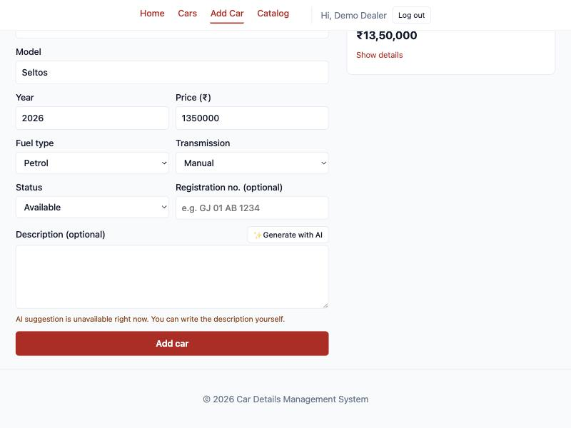
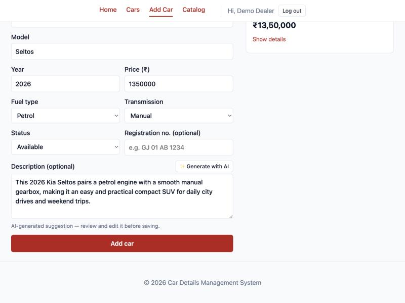

# Week 13 — AI API Integration into a Web Application

## Objective
Add a useful AI feature to the car app with the Gemini API, keep the API key on the backend, make the app keep working when the AI fails, and think through the responsible-AI implications.

## What I built
**Feature:** on the Add / Edit car form, **✨ Generate with AI** writes a short listing description from the car's make, model, year, fuel type and transmission. It saves the dealer from writing the same kind of text for every car, and the result is only a suggestion they can edit.

**Backend**
- `services/ai.js`: calls `POST https://generativelanguage.googleapis.com/v1beta/models/<model>:generateContent` with Node 22's built-in `fetch` (no SDK dependency). The model comes from `GEMINI_MODEL`, default `gemini-flash-latest`, an alias Google keeps pointing at the current Flash model (`gemini-3.8-flash` in the docs today), so the feature does not break when a version is retired.
- **Key handling:** `GEMINI_API_KEY` is read from `.env` on the server and sent in the `x-goog-api-key` header, not in the URL, where it could end up in logs. It is never in frontend code, never in git (checked: 0 matches for `AIza…` in the whole history).
- **Prompt engineering:** a fixed `systemInstruction` — 2–3 sentences, ≤ 60 words, plain text, use only the given details, never invent mileage, owners, condition, features or prices. The user message lists only the provided fields.
- **Timeout:** `AbortSignal.timeout(AI_TIMEOUT_MS)` (10 s) so a slow AI can never hang the request.
- `routes/ai.js` — `POST /api/ai/generate-description`: `auth` → `requireJson` → validation (make and model required) → `rateLimit` → handler.
- **Graceful degradation:** any failure (no key, invalid key, timeout, Gemini 4xx/5xx, empty answer) is logged on the server and returns `200 { description: '', fallback: true, message }`. The client is never shown raw provider errors.
- **Rate limit (post-lab):** `middleware/rateLimit.js` allows one AI request per user every 10 s (`AI_RATE_LIMIT_MS`); otherwise `429` with a `Retry-After` header.
- 7 new automated tests (22 in total) replace `fetch` with a fake Gemini: success, Gemini error, timeout, no key (Gemini is never called), 401, 400, 429, and that the outgoing request carries the key in a header and contains no email, name or registration number.

**Frontend**
- `api/ai.js` calls **our** backend only.
- `CarForm`: the button is disabled until make and model are filled in; while waiting it shows **Generating...** (post-lab loading state); the suggestion fills the **editable** textarea (not raw JSON); a note says *"AI-generated suggestion — review and edit it before saving."* (post-lab disclaimer). On fallback, 429 or a network error it shows a message instead, and **Add car** keeps working.
- `docker-compose.yml` passes an optional `GEMINI_API_KEY` from the root `.env` to the backend container.

## Results
| Check | Result |
|---|---|
| `npm test` | 22 / 22 pass ([`w13-tests.txt`](../evidence/w13-tests.txt)) |
| Backend with **no key**, click the button | "Generating..." → "AI suggestion is unavailable right now. You can write the description yourself."; Add car still enabled |
| Backend with a deliberately **invalid key** | Real call to Google → server log `Gemini responded 400: API key not valid`; client got `200 { fallback: true }` in 0.35 s; `GET /cars` still 200 ([`w13-ai-failure-path.txt`](../evidence/w13-ai-failure-path.txt)) |
| Second click within 10 s | "Please wait 10s before asking the AI again" (429, `Retry-After: 10`) |
| Success path in the UI (response simulated in the browser, no key yet) | Suggestion appears in the textarea with the disclaimer; I edited the text and saved; the saved car shows my edited version |
| Frontend source / built JS | no key and no Gemini URL |

Fallback when the AI is unavailable:

Suggestion in the editable field with the disclaimer:

**Live test with a real key** ([`w13-live-gemini.txt`](../evidence/w13-live-gemini.txt)): `gemini-flash-latest` and `gemini-3.8-flash` answered **503 "high demand"** — exactly the case graceful degradation is for. `gemini-3.5-flash-lite` answered in 2.1 s with a 3-sentence, 49-word description that used only the given facts (no invented mileage, owners or price). Set `GEMINI_MODEL=gemini-3.5-flash-lite` in `.env` while the larger models are overloaded.

## Key questions
**Why must the AI API key be used from the backend and not directly from React?**
Everything in the React bundle is downloaded to every visitor's browser. A key there can be read from the JavaScript or the DevTools Network tab in seconds, and anyone could then use my quota or run up a bill. The backend keeps the key in an environment variable, adds authentication (only logged-in users), validation and a rate limit, and controls exactly which data is sent.

**What does graceful degradation mean here, and why does it matter for a third-party service?**
The AI is an optional helper, so its failure must not break the core job of adding a car. Gemini can be down, slow, out of quota or reject the key — none of that is under my control. Every failure becomes a calm "unavailable, write it yourself" message, the description field stays usable, and saving works. I tested this with no key, an invalid key and a simulated timeout.

**What are the privacy and governance implications of sending data to an external AI API, and what must never be sent?**
Whatever I send leaves my system and is processed (and possibly stored or logged) by another company under its own terms. So I send only what the task needs: make, model, year, fuel type, transmission. **Never sent:** the user's name, email or password, JWTs or API keys, the registration number (it identifies a specific vehicle and so its owner), and any free text the user typed that might contain personal details. A test enforces this. Governance-wise: the output is labelled as AI-generated, the human reviews and edits it before it is saved (the AI never saves anything itself), the prompt forbids inventing facts like mileage or condition that could mislead a buyer, and the rate limit caps cost and abuse.

## Errors & fixes
| Symptom | Cause | Fix |
|---|---|---|
| (avoided) A hardcoded model name stops working when Google retires that version | Model versions change often — the docs already list newer models than I expected | Default to the `gemini-flash-latest` alias, configurable with `GEMINI_MODEL` |
| (avoided) Key leaking through logs or proxies | Passing it as `?key=` in the URL | Sent in the `x-goog-api-key` header |
| (avoided) Request hanging on a slow AI | `fetch` has no timeout by default | `AbortSignal.timeout(10000)`; tested with a simulated `TimeoutError` |
| A second click right after the first did not show the rate-limit message | Over 10 s had passed between my two clicks, so the window had reset — not a bug | Re-tested with two clicks 0.9 s apart → 429 message |

## Post-lab work done
- [x] Loading state on the frontend while waiting for the AI response
- [x] Visible disclaimer that the content is AI-generated and should be reviewed
- [x] Supplementary: per-user rate limit (1 request / 10 s, 429 + `Retry-After`)
