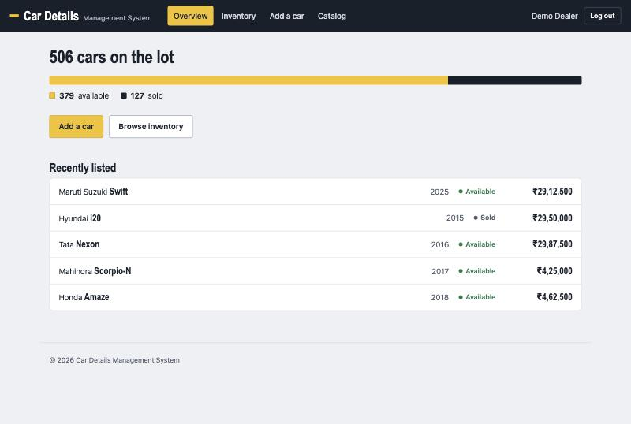
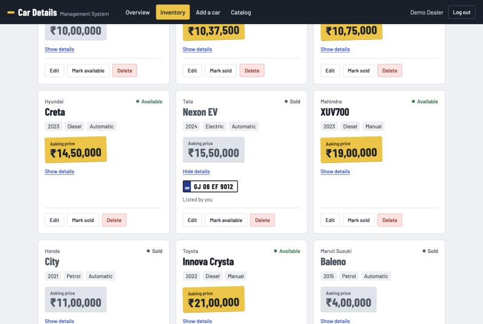
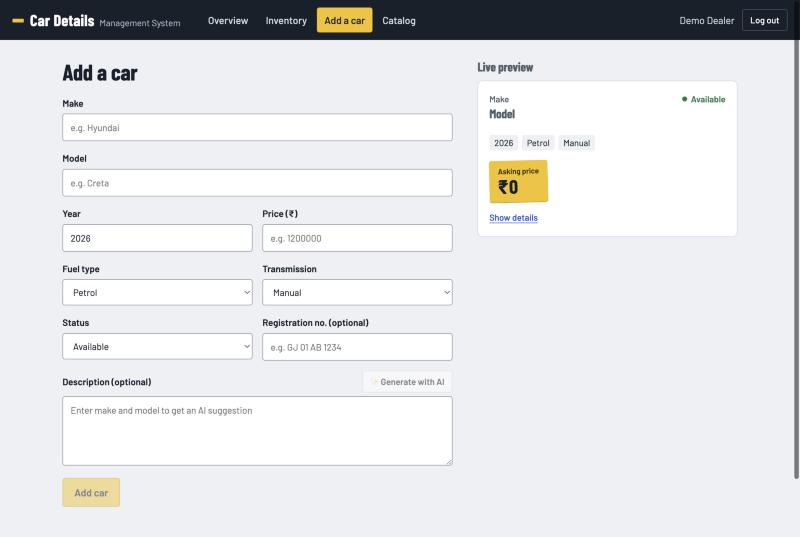
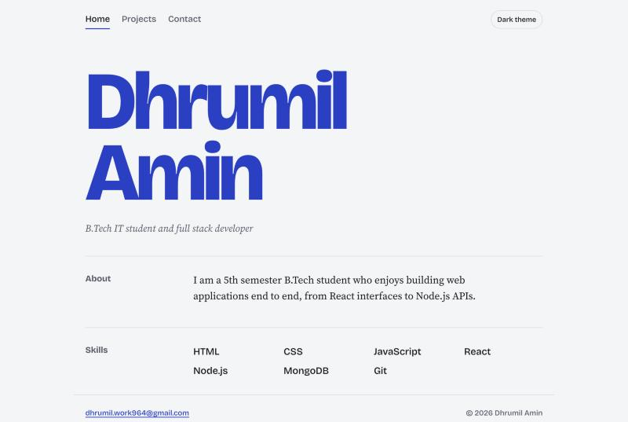
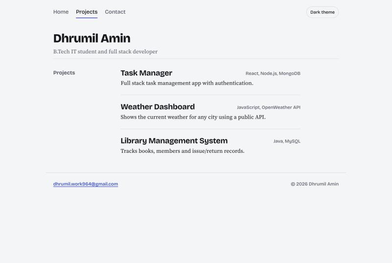
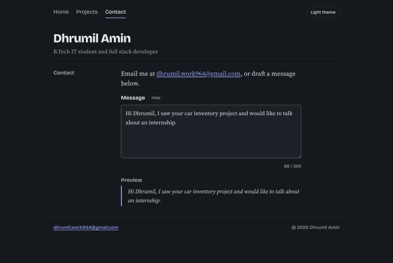

# UI redesign

Both apps were redesigned after the 13 practicals and 7 assignments, keeping every feature and requirement (routes, details toggle, controlled forms, dark mode, `themeColor` prop, A7 accessibility tokens).

## Car Details Management System — "lot desk"
A dealer's inventory desk: asphalt, concrete and road-marking yellow.

| Token | Value | Use |
|---|---|---|
| `--asphalt` | `#18202B` | app bar, text, sold share of the lot bar |
| `--concrete` | `#EDF0F3` | page background |
| `--marking` | `#F4C21A` | price stickers, primary action, active nav — the only bold colour |
| `--muted` | `#535E6C` | secondary text (5.8:1 on concrete) |
| `--go` / `--stop` | `#1F7A4D` / `#B42318` | available status / destructive |

- **Type:** Barlow Condensed (road-sign / automotive grotesque) for model names, prices and number plates; Barlow for body text.
- **Signature element:** each car card is a windshield sticker — the asking price on a yellow sticker, set slightly askew; sold cars get a grey sticker. Registration numbers render as an Indian number plate (`GJ 06 EF 9012` with the blue IND strip).
- **Overview:** "506 cars on the lot", a proportional available/sold bar, two actions and a recently-listed table — instead of three generic stat boxes.
- All 19 text/background pairs checked: every one meets WCAG AA (lowest 5.16:1 for text, 3.06:1 for input borders). The focus ring is asphalt on light surfaces and yellow on the dark app bar.

## Portfolio — type specimen
- **Type:** Bricolage Grotesque for the name, headings and lists; Source Serif 4 for reading text.
- **Signature element:** on the home page the name is set huge on two lines in the accent colour, which comes from Header's `themeColor` prop. On other pages it shrinks to a normal title.
- **Layout:** sections with the heading on the left and content on the right, like a CV; projects as a typeset list; the contact preview as a quoted letter.
- **Themes:** light (`#F4F5F7` paper, `#15171C` ink, `#2340C8` cobalt) and dark (`#15181E` paper, `#E8EAEF` ink, `#93A8FF` accent). All pairs meet AA (lowest 6.26:1 for text).
- Verified at 390 px: no horizontal scroll on any page.

